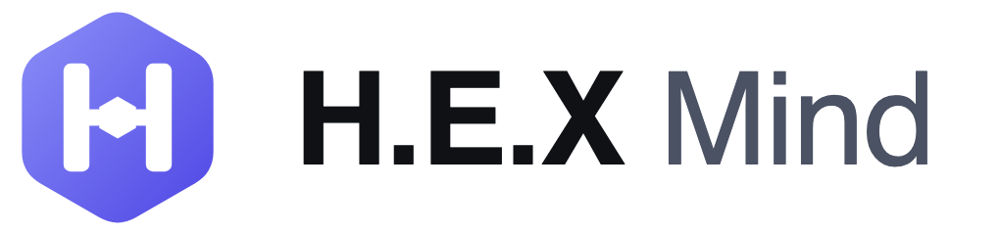
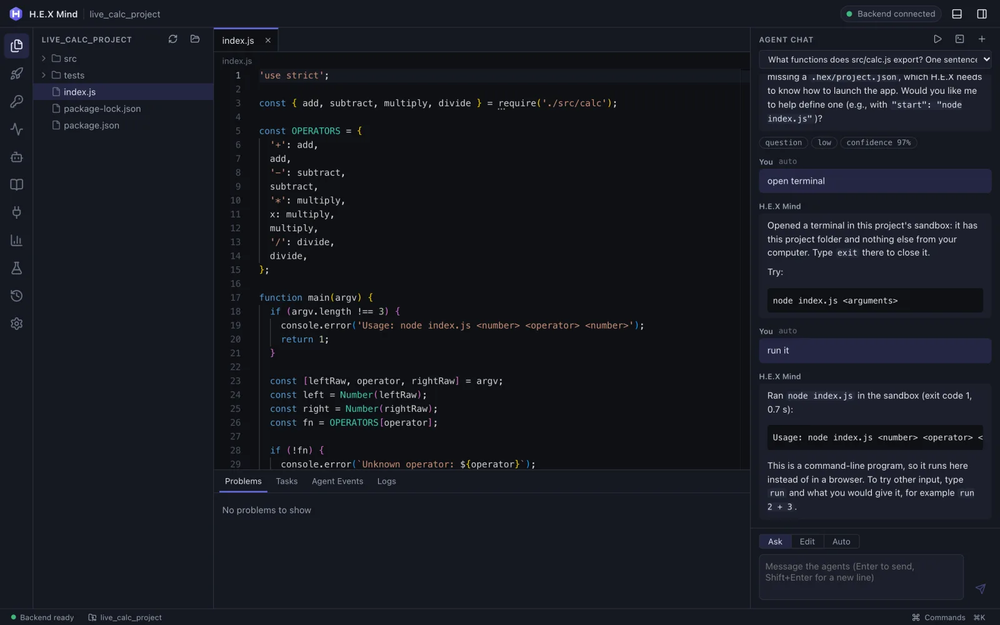
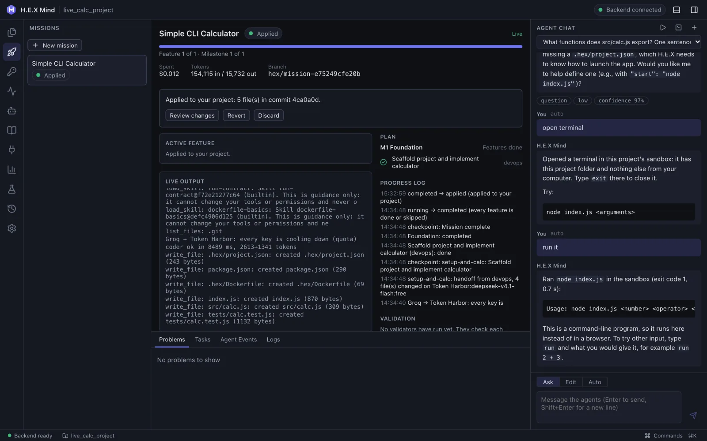
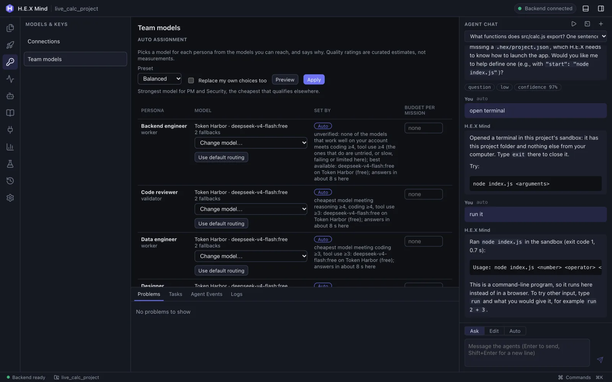
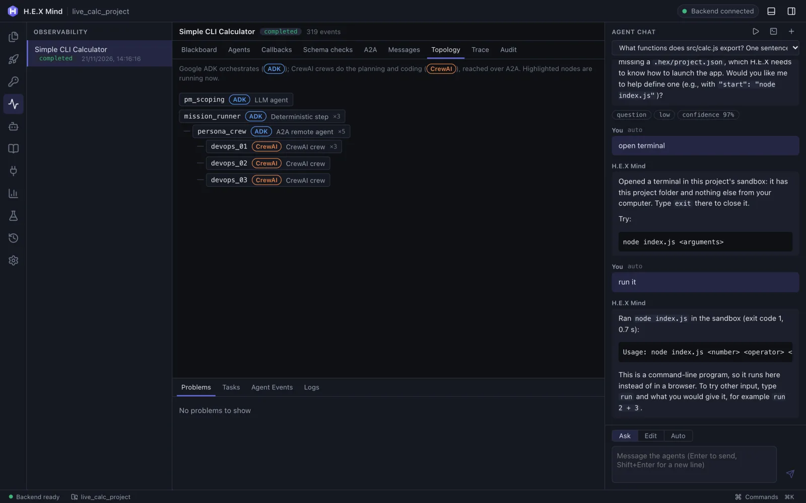
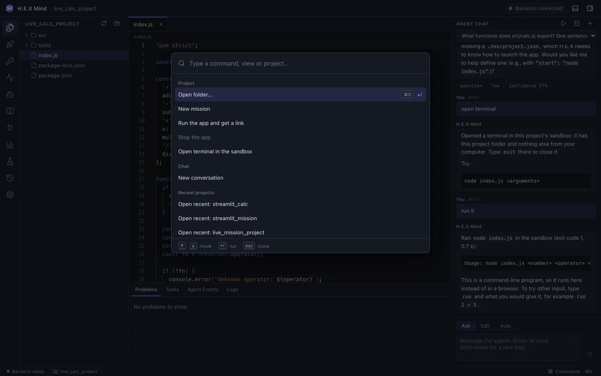
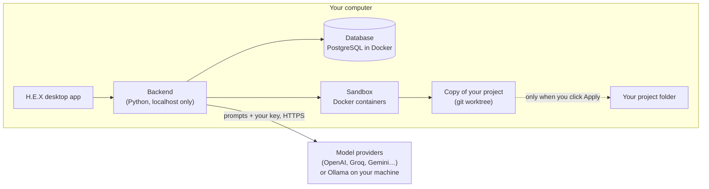
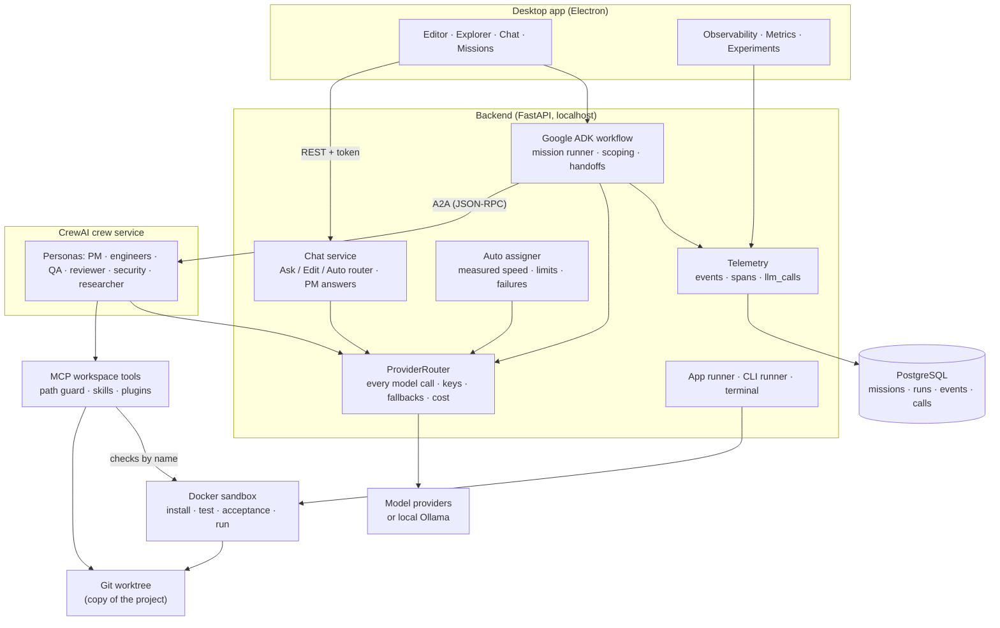
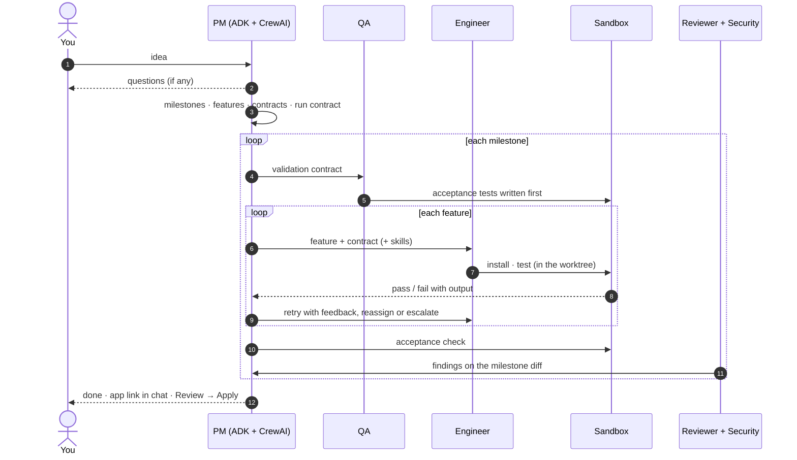

<div align="center">

<picture>
  <source media="(prefers-color-scheme: dark)" srcset="design/logo/lockup-dark.png">
  
</picture>

### Your AI software team, on your own computer.

Describe an idea. A PM plans it, engineers build it, QA and security check it in a sandbox,<br>
and you review the result before a single file of yours changes.


[What it does](#what-it-does) · [Install](#install) · [First mission](#your-first-mission) · [How it runs](#where-does-the-code-run) · [Architecture](#architecture) · [Agents](#the-agent-team) · [Scope and safety](#agentic-scope-and-safety) · [Compared](#how-it-compares) · [Status](#status-and-roadmap)

<br>



</div>

---

## What it does

Most AI coding tools are one agent doing everything: planning, writing, and grading its own work. H.E.X Mind is a **team**. Each member has one job, its own model, its own skills, and nobody marks their own homework.

| You say | What happens |
|---|---|
| *"Build a Streamlit calculator with tests."* | The **PM** asks what it needs, then splits the idea into milestones and features with a contract for each. |
| | **Engineers** (backend, frontend, data, designer, DevOps) build each feature in an isolated copy of your project. |
| | **QA** writes acceptance tests from the contract *before* the code exists; **Reviewer** and **Security** check the diff. |
| | Every check (install, tests, acceptance) runs in a **Docker sandbox**. Results come from the sandbox and git, never from what an agent claims. |
| *"run it"* | H.E.X starts the app in the sandbox and posts a **localhost link** in the chat. A command-line program runs right in the chat: *"run 2 + 3"*. |
| *Apply* | Only now do your files change, in one commit you can revert. |

**Highlights**

- 🧠 **Any model, per team member.** OpenAI, Anthropic, Gemini, Groq, DeepSeek, Mistral, xAI, NVIDIA, OpenRouter, Ollama (local) or any OpenAI-compatible endpoint. **Auto** picks a model for each role from what *your* account can call, measured: free first, refused never, speed and rate limits shown.
- 🛡️ **Safe by default.** Agents work in a git worktree; generated code only runs in a hardened container; API keys never reach the sandbox, the UI, logs or git.
- 🔭 **Full observability.** A live team view (who is working on what, right now, from real events), agent topology (ADK → A2A → CrewAI), every model call with tokens, cost and latency, and a trace per run.
- 🧩 **Skills and plugins.** 28 built-in skills (SKILL.md), install more from GitHub (Claude and Codex skills work), and attach MCP servers per team member.
- ⌨️ **Feels like an IDE.** Monaco editor, file explorer, command palette (<kbd>⌘K</kbd> / <kbd>Ctrl+K</kbd>), keyboard shortcuts, status bar, a terminal into the project's sandbox.
- 📏 **Measured, not claimed.** A built-in evaluation harness (benchmark missions with hidden tests) to compare models and setups.

<table>
<tr>
<td width="50%"><br><sub><b>Mission control.</b> Plan, live output, spend and tokens; review, apply or revert.</sub></td>
<td width="50%"><br><sub><b>Team models.</b> Auto explains each choice with what it measured on your account.</sub></td>
</tr>
<tr>
<td><br><sub><b>Observability.</b> Which framework did what: ADK orchestrates, CrewAI crews work, over A2A.</sub></td>
<td><br><sub><b>Command palette.</b> Every view, action and recent project, one keystroke away.</sub></td>
</tr>
</table>

---

## Install

H.E.X Mind runs on **macOS, Windows and Linux**. You need four free tools first:

| Tool | Why | Get it |
|---|---|---|
| **Node.js 20.12+** | the desktop app | [nodejs.org](https://nodejs.org) |
| **Git** | agents work in a git copy of your project | [git-scm.com](https://git-scm.com/downloads) |
| **uv** | runs the Python backend | [docs.astral.sh/uv](https://docs.astral.sh/uv/getting-started/installation/) |
| **Docker Desktop** (running) | the database and the sandbox | [docker.com](https://www.docker.com/products/docker-desktop/) |

Then:

```bash
git clone https://github.com/shreytiwari09/HEX-MIND.git
cd HEX-MIND
npm run setup     # checks the tools, creates .env with fresh secrets, installs, starts the database
npm start         # starts the backend and opens the app
```

`npm run setup` is safe to run again. It never overwrites your `.env` and never prints a secret.

**Prefer a normal app icon?** `npm run package` builds an installer for the computer you run it on (`.dmg` on macOS, `.exe` on Windows, `AppImage` on Linux) in `apps/desktop/release/`. The installer holds the desktop app; start the backend with `npm run backend` before opening it. Builds are not code-signed, so macOS asks you to confirm the first launch (right-click → Open).

**Add a model.** In the app: **Models & Keys → Connections**. Free keys from [Groq](https://console.groq.com) or [Google AI Studio](https://aistudio.google.com) are enough to start; [Ollama](https://ollama.com) runs models fully offline. Then **Team models → Auto → Apply**. Keys are stored in your operating system's key store, never in the repository.

## Your first mission

1. **Open a folder** (<kbd>⌘O</kbd>): an empty one for a new app, or an existing project.
2. **Missions → New mission.** Describe the idea in a few sentences. The PM may ask a question or two.
3. **Watch.** Progress appears in the mission screen and in its own chat conversation.
4. **Try it before you keep it.** When the mission ends, a web app starts automatically and its link appears in chat. Say *"run it"* any time, *"run 12 / 4"* for a command-line program, or *"open terminal"* for a shell in the sandbox.
5. **Review changes → Apply** (or Discard). Applied work is one commit; **Revert** undoes it. The team's working copy is deleted once you apply.
6. **Next steps** (on the mission screen): **Prepare for GitHub** adds `.env.example`, a CI workflow that runs your tests on every push, Dependabot and deploy notes; **Publish** creates a private GitHub repository with your own `gh` login (H.E.X never sees a GitHub token) and pushes it.

---

## Where does the code run?

**Everything runs on your computer.** There is no H.E.X server and no account.



- **Your code** stays on your disk. The agents edit a *copy*; your folder changes only when you apply.
- **What leaves your computer** is only what a model needs to answer: the prompt (task, contracts, relevant file excerpts) sent to the provider *you* chose, with *your* key. With Ollama, nothing leaves at all. Per-project privacy settings can block hosted models entirely.
- **Generated code** runs only inside Docker containers: no root, no capabilities, read-only system, memory and process limits, only the project folder mounted, and no API keys. Tests run with no network; installs reach package registries only; apps you start can use the internet (like any app you run).
- **Apps it builds** open at `http://localhost:<port>`: reachable from your browser, not from your network.

### And "deploying to the cloud"?

Deploying means running those same parts on rented computers instead of yours, so you can use H.E.X from anywhere and leave missions running with your laptop closed. On **Google Cloud (GCP)** that would look like this (planned as phase P9; **not built yet**):

| Part | On your computer today | On Google Cloud |
|---|---|---|
| Backend | Python process on localhost | **Cloud Run** (a container Google starts on demand) |
| Database | PostgreSQL in Docker | **Cloud SQL** for PostgreSQL |
| Sandbox | Docker on your machine | Isolated **Cloud Run jobs / GKE** containers, one per check |
| Your projects | folders on your disk | a **Cloud Storage** bucket or git repository |
| Keys | OS key store | **Secret Manager** |
| Screen | the desktop app | the same app pointed at the cloud backend, or a web version |

The trade-offs: it costs money every month (database and compute), you need sign-in so only you can reach it, and your code then lives on Google's servers. Apps H.E.X builds could also be published to a public URL from there (with an explicit *Publish* step). Until then, H.E.X is local-first by design.

---

## Architecture



- **Two agent frameworks, one protocol.** Google ADK owns the mission workflow (deterministic steps and LLM agents); each persona is a CrewAI crew in a separate service, reached over **A2A**. Neither framework calls a model directly: every call goes through `ProviderRouter`, which picks the connection, applies fallbacks and rate-limit cooldowns, and records tokens, cost and latency.
- **MCP is the agents' only way to touch files.** Reads and writes are path-guarded to the worktree; checks run by *name* (`install`, `test`, `acceptance`) from the project's run contract, so an agent cannot run arbitrary commands on your machine.
- **Evidence over claims.** A feature is done when its checks pass in the sandbox; the changed files come from `git diff`, not from the agent's report.

### How a mission runs



---

## The agent team

| Member | Role | Skills it starts with | Writes code? |
|---|---|---|---|
| **PM / Tech Lead** | orchestrator | scoping interview, PRD writing, feature decomposition, API contracts, failure handling, escalation | plans and contracts only |
| **Researcher** | research | deep research, docs research (optional web search) | no |
| **Backend engineer** | worker | REST APIs, auth basics, backend testing | yes |
| **Frontend engineer** | worker | React UI, state and data fetching, frontend testing | yes |
| **Data engineer** | worker | relational schema design, migrations | yes |
| **Designer** | worker | UI/UX, accessibility, design tokens | yes (UI) |
| **DevOps (local)** | worker | run contract, Dockerfiles, project layout | yes (setup) |
| **QA engineer** | validator | acceptance testing | tests only |
| **Code reviewer** | validator | code review, contract conformance | no |
| **Security reviewer** | validator | security audit, secrets hygiene | no |

Every member is editable in **Agents**: instructions, skills, plugins (MCP servers), model and a per-mission budget. You can add your own personas.

## Agentic scope and safety

**What the agents can do**

- Read and write files **inside the mission's worktree** (a git copy of your project).
- Run the project's named checks (`install`, `test`, `acceptance`, `typecheck`, `lint`) **in the sandbox**.
- Load skills and call the MCP plugins you attached to them.
- Search the web, only the Researcher and only when you turn on *Advanced research*.

**What they cannot do**

- Touch your project folder (that takes your *Apply*), or any path outside the worktree.
- Run arbitrary shell commands on your computer, see your API keys, or reach the network from tests.
- Mark their own work done: completion is decided by sandbox results and validators.

**Where you stay in charge**

- Answering the PM's scoping questions, and approving its plan before the team builds.
- *Needs* the team raises (a missing key, a decision) wait for you.
- Review → Apply / Discard / Revert. Budgets per persona and per mission stop spending.

Third-party skills and plugins are treated as untrusted: they are scanned, shown before install, and run with the same limits.

---

## How it compares

A November 2026 survey of 17 tools ([full report with sources](research_notes/Agent%20coding%20tools%20gap%20analysis.md)):

| | H.E.X Mind | App builders (Lovable, Bolt, Replit, v0) | Cloud agents (Devin, Copilot agent, Cursor, OpenHands) | IDE / CLI agents (Claude Code, Cline, Aider, Kiro) |
|---|---|---|---|---|
| Fixed team of roles, model per role from any provider | ✅ | ❌ | ❌ | partly (subagents) |
| QA writes acceptance tests first; separate security review | ✅ | ❌ | ❌ | ❌ |
| Your files change only on approval; code runs in a sandbox | ✅ | hosted copy | branch / PR | varies |
| Per-call tokens, cost and latency | ✅ | credits | partly | partly |
| Runs locally, no account | ✅ | ❌ | ❌ | ✅ |
| Live preview pane, visual edits | ❌ (localhost link) | ✅ | partly | partly |
| One-click publish to a public URL | ❌ (planned, P9) | ✅ | Cursor only | ❌ |
| Built-in database, sign-in, payments | ❌ | ✅ | ❌ | ❌ |

## Status and roadmap

Built and tested (1,000+ backend tests, ~290 desktop tests): phases P1–P8 of the [PRD](PRD.md), including missions, team models with Auto, skills and plugins, observability, metrics and the evaluation harness. Live missions have run end to end on free models.

**Not built yet**, most valuable first:

1. **Publish to a public URL** and cloud hosting (P9, see above).
2. A **live preview pane** inside the app, and click-to-change on it.
3. **Browser tests** by QA with screenshots as proof.
4. **Image / screenshot / Figma input** for the designer.
5. One-click **undo to a milestone** (today: Revert undoes the whole applied mission).
6. A terminal built into the app (today it opens your system terminal, inside the sandbox).

---

## Development

```bash
npm start                 # backend + desktop app (from source)
npm run dev:backend       # backend only (FastAPI on 127.0.0.1:$HEXMIND_PORT)
npm run dev               # desktop app only
npm test                  # desktop + backend tests
npm run typecheck && npm run lint:backend
npm run package           # installer for this OS
```

```
apps/desktop/    Electron main (window, app:// protocol), preload (3 calls), React renderer
apps/backend/    FastAPI: orchestration (ADK), agents (CrewAI), a2a, providers, router,
                 mcp_server, sandbox, workspace, missions, catalog, telemetry, evaluation
design/logo/     logo, app icon and lockups (SVG + PNG)
docs/standards/  coding standards the agents load at runtime
PRD.md           product requirements and every decision (§21)
```

Hard rules for contributors are in [CLAUDE.md](CLAUDE.md): CrewAI and Google ADK only, every model call through `ProviderRouter`, keys never leave the backend, generated code is untrusted.

## License

[MIT](LICENSE) © 2026 Shrey Tiwari
